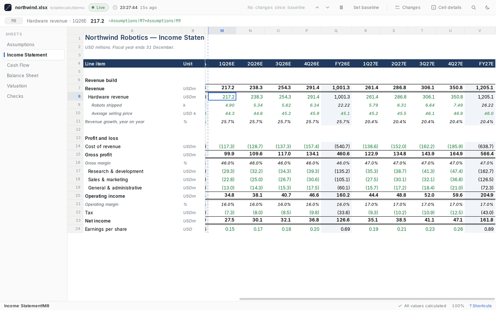
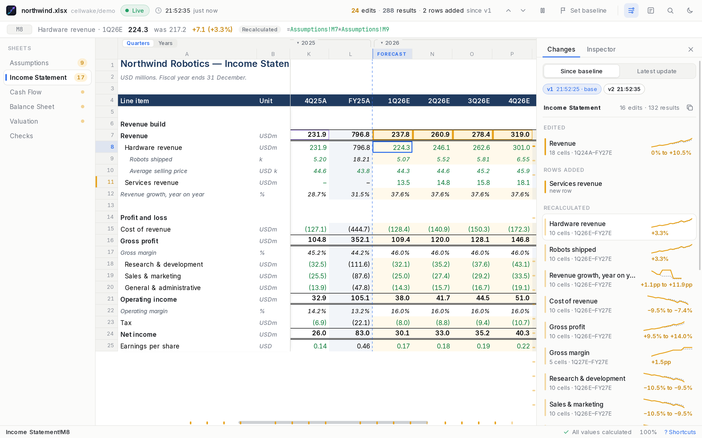
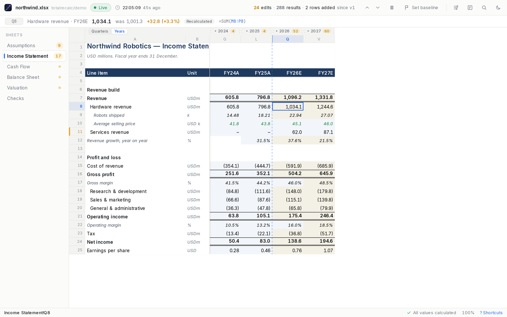
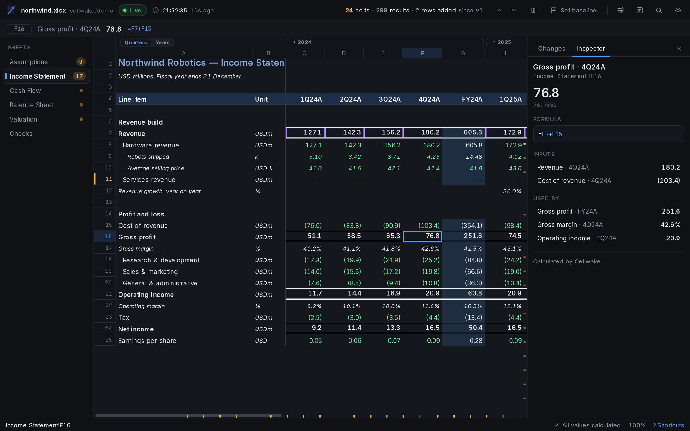

<p align="center">
  
</p>

<p align="center"><b>Open your mind. Not your file.</b><br/>
A fast, read-only viewer for Excel workbooks that refreshes itself the moment the file changes, keeps your place, and shows exactly what the agent edited and what recalculated as a result.</p>

<p align="center">
  
</p>

---

## Why

More and more spreadsheet work happens by asking an agent to change a model: "raise next year's unit growth", "add a services line", "rebuild the balance sheet". The agent rewrites the `.xlsx`; you want to look at it, talk about it, and watch it change.

Excel and LibreOffice are the wrong tools for that loop. They lock the file, so the agent cannot save. They do not reload when the file changes underneath them. And when they do reopen, nothing tells you which of ten thousand cells just moved.

Total Recalc is built for that loop:

- **It never touches the file.** It reads the workbook into memory and lets go, so an agent can overwrite, replace or delete it at any time.
- **It follows along.** When a new version lands it refreshes within about a second, on the same sheet, scrolled to the same place, with the same cell selected, even if rows were inserted above it.
- **It shows what changed, honestly.** Cells the agent *edited* are separated from cells that merely *recalculated*, so "3 edits · 240 results" is the headline rather than a carpet of highlights.
- **It hands numbers back.** *Copy with context* puts the sheet, row label, period, value, formula and previous value on your clipboard as Markdown, ready to paste to the agent.

## Features

| | |
|---|---|
| **Live reload** | Watches the folder (agents usually write a temporary file and rename it over the original) and polls as a fallback. A half-written file is never shown. |
| **The wake** | Each update ripples across the changed cells in reading order, then settles into a tint. Edited cells carry an amber bar; formula-only edits a violet one; recalculated results a faint tint. Tick marks on the scrollbars show where changes sit off-screen. |
| **Edits versus results** | Rows are matched between versions by their labels and aligned like lines in a text diff, and old formulas are rewritten through that alignment before comparison. An inserted row is one new row, not a shift of everything below it. |
| **Changes panel** | Every change since your baseline, grouped by row, with the period span, the range of moves and a before/after sparkline. Switch between *since baseline* and *latest update*; set a new baseline at any time (with Undo). |
| **Pause** | Hold the version on screen while you talk about it. Total Recalc keeps watching and tells you how many newer versions are waiting. |
| **Inspector** | The selected cell's value, previous value, formula (with clickable references), its inputs and everything that uses it. Follow a chain with Enter, come back with Backspace. |
| **Quarters and years** | Period headers like `1Q25A` and `FY2025E` are recognised and quarters fold under their year. Collapse to annual columns with one key; where a year has no annual column of its own, Total Recalc shows a clearly marked derived one. |
| **Faithful rendering** | Number formats, fonts, fills, borders, merged cells, frozen panes, hidden rows and columns, comments and Excel-style text overflow. Light mode looks like Excel; dark mode remaps workbook colours so dark header fills and blue inputs stay legible. |
| **Honest numbers** | Every version is recalculated by a built-in engine ([IronCalc](https://github.com/ironcalc/IronCalc)). Where a file saved by Excel disagrees with the engine (functions it handles differently), Excel's saved value is shown and marked as coming from the cache. |
| **Command palette** | `Ctrl+K` for every action, sheet and row label. `Ctrl+G` goes to a cell or label, `Ctrl+F` searches the sheet. |

<p align="center">
  
</p>

<p align="center">
  
  
</p>

## Try it

Download the latest build from the [releases page](https://github.com/thomasrice/totalrecalc/releases/latest): an installer or a portable `.exe` for Windows, or an `.AppImage` or `.deb` for Linux (macOS is untested). Then open a workbook:

```sh
totalrecalc path/to/model.xlsx
```

Or drag a file onto the window. To see it follow an agent, open the bundled demo model and run the demo agent, which revises it every few seconds:

```sh
totalrecalc demo/northwind.xlsx &
uv run --with openpyxl demo/agent.py demo/northwind.xlsx
```

## Keyboard

| Keys | Action |
|---|---|
| Arrows · `Ctrl`+arrows · `PgUp`/`PgDn` | Move · jump to the edge of data · page |
| `Shift` + movement | Extend the selection |
| `Ctrl+PgUp` / `Ctrl+PgDn` | Previous / next sheet |
| `N` / `Shift+N` | Next / previous edit, across sheets |
| `Space` | Pause or resume live updates |
| `F5` | Set the baseline to the version on screen |
| `D` · `I` (or `F2`) | Changes panel · Inspector |
| `Enter` / `Backspace` | Follow the first input / go back |
| `[` / `]` | Collapse to years / expand quarters |
| `Ctrl+C` · `Ctrl+Shift+C` | Copy · copy with context |
| `Ctrl+K` · `Ctrl+G` · `Ctrl+F` | Command palette · go to · find |
| `Ctrl` + scroll · `Ctrl+0` | Zoom · reset |
| `T` | Light or dark |

## How it works

Total Recalc is a [Tauri 2](https://tauri.app) app. The Rust side does the work: it reads the workbook with IronCalc (plus a little direct XML for outline levels and the odd package quirk), recalculates it on a background thread, keeps the last 30 versions in memory, diffs them, and answers the window's requests one sheet at a time. The window is TypeScript with no framework: a virtualised grid that only puts visible cells in the DOM, split into frozen and scrolling panes driven by native scrollbars.

A version is accepted only once the file's size and timestamp have been stable for half a second and it parses as a complete workbook. If reading fails, the last good version stays on screen and the top bar says what is wrong.

## Building from source

You need Rust (stable), Node 22 and pnpm. On Linux, also the WebKitGTK development packages (`libwebkit2gtk-4.1-dev` on Debian/Ubuntu, `webkit2gtk-4.1` on Arch).

```sh
pnpm install
pnpm tauri dev            # run with hot reload
pnpm tauri build          # release build and installers
```

The UI also runs in a plain browser against JSON fixtures, which is handy for working on the interface: `pnpm dev` and open `http://localhost:1420/?fixture=demo`. The fixtures are made by `totalrecalc-dump`, a small command that loads one or two workbooks and prints exactly what the window would receive; see [fixtures/README.md](fixtures/README.md).

The demo model is generated by `demo/northwind.py`; rebuild it with `uv run --with openpyxl demo/northwind.py demo/northwind.xlsx`.

## Limitations

- Viewing only, by design: no editing, saving or exporting.
- `.xlsx` and `.xlsm` only. Charts and images are not drawn.
- Calculation uses IronCalc, which covers most of Excel but not all of it. Where the file carries Excel's own results those are preferred and marked; a workbook written by a script without saved results relies on the engine alone.
- Change detection compares values and formulas, not formatting.

## Status

Early, and used daily on Linux. Windows builds come from CI. See [CHANGELOG.md](CHANGELOG.md).

## Licence

[MIT](LICENSE)
